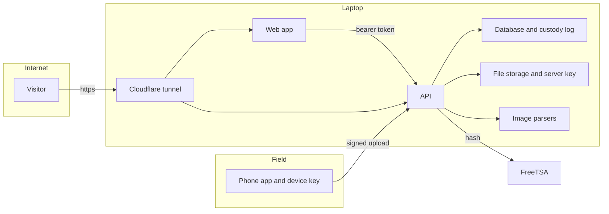

# ChainProof threat model

Version: 31 Oct 2026, branch `phase2` (commit after e03bf95). Method: repository-grounded threat modelling (data flows,
trust boundaries, abuse paths, likelihood × impact). Every claim cites a repo path.

## Executive summary

ChainProof's evidence-integrity design holds against the attacks it was built for: a changed file, a forged manifest, an
edited custody row and a forged PDF are all detected. The highest risks sit **around** that core. The custody log is
signed with a key stored on the same machine as the database, so whoever controls the laptop can rewrite history and
re-sign it (TM-001). Any investigator can enrol a signing device without approval, so "verified capture" proves the
account's device, not the scene (TM-002). During public demos, unchanged demo passwords give an internet visitor full
access (TM-003). The forensics layer can be steered: fake AI metadata makes a real photo read "AI-generated" (TM-011).
Demo-day availability is fragile: one person can lock everyone out through the tunnel (TM-004).

**Status, 1 Nov 2026 (branch `phase2`):** the four quick fixes and the main part of TM-001 are in, each with a test. The tables below describe the
code as it was when this model was written; read them together with this list.

| Threat | Now | Tested in |
|---|---|---|
| TM-001 | Every verify and report export timestamps the newest entry's hash with FreeTSA and appends it as an `ANCHORED` entry (`server/app/core/anchor.py`); both PDFs print it. A rewrite re-signed with the server key no longer matches the old anchors, and new anchors carry the rewrite's date. Entries after the latest anchor are still protected only by the key, and the key still sits next to the database | `tests/test_anchor.py`; live FreeTSA round trip; `tamper_demo --resign` on a throwaway database |
| TM-003 | `demo.sh` refuses to start while any account uses `chainproof123`, and also stops if the check itself fails | gate run by hand; `scripts/check_demo_passwords.py` exits 3 |
| TM-004 | Under `demo.sh`, login limits use Cloudflare's `CF-Connecting-IP` (`CHAINPROOF_TRUST_CF_CONNECTING_IP`, off by default because without Cloudflare anyone could send it); a supervisor's password reset lifts that account's lockout | `tests/test_security.py` |
| TM-005 | `POST /public/verify` refused over 210 MB before parsing (Content-Length and a running byte count), hashed in 1 MB chunks; both public verify routes limited to 30 per minute per visitor | `tests/test_security.py` |
| TM-011 | *AI-generated* only when a C2PA manifest validates **and** its signer is on the official C2PA trust list (`server/app/forensics/c2pa_trust_list.pem`). A self-signed AI claim and an AI name in metadata are medium findings. ChatGPT's credentials still come out Trusted | `tests/test_forensics.py` (forges a self-signed credential); before the fix it read *AI-generated*, now *Suspicious* |

## Scope and assumptions

**In scope:** the API (`server/app`), the web app (`apps/web`), the phone app's signing and key storage
(`apps/mobile/src/lib`), and the demo exposure (`demo.sh`).

**Out of scope:** CI and dev tooling (`.github/workflows`, Expo CLI advisories) except where noted, Cloudflare's
infrastructure, and phone OS compromise beyond a stolen, unlocked phone.

**Assumptions (confirmed with the owner on 31 Oct 2026):**
- **Today:** one laptop runs everything; it is reachable from the internet only while `./demo.sh` runs a Cloudflare quick tunnel.
- **Later:** a hosted deployment for real cases is possible; where it changes a ranking, this is noted.
- **Users:** only the team and teachers have accounts (investigator, supervisor and auditor roles). Single tenant.
- **Attackers considered:** an internet visitor during demos, a dishonest investigator with a normal account, someone with
  access to the laptop or its database, and someone who steals an enrolled phone.

**Open questions that would change rankings:**
1. Will a hosted deployment keep the server signing key on the same host as the database?
2. Will evidence ever be used outside the course (real cases)? If so, TM-001 and TM-002 become critical.

## System model

### Primary components
- **Phone app (Expo):** captures, hashes and signs evidence with a per-device Ed25519 key in SecureStore. Evidence: `apps/mobile/src/lib/device.ts` (`keychainAccessible: WHEN_UNLOCKED_THIS_DEVICE_ONLY`).
- **API (FastAPI):** authentication, cases, evidence ingest, custody chain, forensics, reports, public verify. Evidence: `server/app/main.py`, `server/app/routers/*`.
- **Database (SQLite, Postgres optional):** cases, evidence records and the custody log, with triggers that block UPDATE/DELETE. Evidence: `server/app/db.py` (`custody_no_update`, `evidence_frozen`).
- **File storage:** content-addressed originals plus derived files (thumbnails, overlays, difference maps), **and** the server's Ed25519 key and the JWT secret. Evidence: `server/app/storage.py`, `server/app/core/signing.py` (`server_ed25519.pem`), `server/app/core/security.py` (`jwt_secret`).
- **Web app (Next.js):** staff UI with a bearer token in `localStorage`, plus the public verify page. Evidence: `apps/web/src/lib/api.ts` (`tokenStore`).
- **External:** FreeTSA (RFC 3161 timestamps) at `https://freetsa.org/tsr`, with its certificate pinned; Cloudflare quick tunnels during demos. Evidence: `server/app/config.py` (`tsa_cert_sha256`), `demo.sh`.

### Data flows and trust boundaries
- **Internet → Cloudflare tunnel → API and web** (demo only): HTTPS to Cloudflare, then HTTP to localhost. Carries logins, public verify uploads and staff traffic.
  - Authentication: none at the edge.
  - Rate limiting: only the in-app login limiter. All tunnelled clients reach the API from `127.0.0.1`, so the per-IP part of the limiter sees a single client.
  - Evidence: `demo.sh` (`cloudflared tunnel --url http://localhost:$1`), `server/app/routers/auth.py` (`request.client.host`).
- **Phone → API** (`POST /cases/{id}/evidence`): file bytes, a signed manifest, a JWT. Checked against the manifest:
  - hash and size
  - case, user and device
  - the device is not revoked
  - an Ed25519 signature over RFC 8785 canonical JSON

  Uploads are capped at 200 MB. Evidence: `server/app/routers/evidence.py`, about lines 70–95.
- **Web/staff → API:** a JWT (HS256, from login with Argon2 hashes) and role checks with `require_role`. Uploads for analysis are capped at 40 MB. Evidence: `server/app/core/security.py`, `server/app/routers/forensics.py` (`MAX_ANALYZE`).
- **Anyone → public verify:** a SHA-256 hash or a whole uploaded file. No authentication. The file is hashed, never stored, and **no size limit** applies. Evidence: `server/app/routers/verify.py` (`public_verify_file`).
- **API → FreeTSA:** evidence hashes out, signed tokens back. The token signer must match the pinned certificate. Evidence: `server/app/core/tsa.py`.
- **API → file storage and database:** local filesystem and SQL. Integrity rests on the hash chain, server signatures and DB triggers. Evidence: `server/app/core/chain.py` (`append_entry`, `server_sign`).
- **Untrusted image bytes → parsers:** Pillow, OpenCV and c2pa-python read files supplied by investigators, which may come from the public (tips) or a suspect's device. Evidence: `server/app/forensics/common.py` (`open_rgb`), `server/app/forensics/c2pa_check.py`.

#### Diagram

## Assets and security objectives

| Asset | Why it matters | Objective |
|---|---|---|
| Custody log (hash chain + server signatures) | The legal record of who did what; the core claim of the product | I |
| Server Ed25519 key (`storage/server_ed25519.pem`) | Signs every custody entry; with it, a rewritten log verifies as genuine | C, I |
| Evidence originals and their hashes | Must be the bytes captured; any change must be detectable | I, A |
| Device signing keys (phones) | Make "verified capture" mean something | C, I |
| Staff accounts and the JWT secret | Control every write, including examinations and password resets | C, I |
| Forensic findings and examination conclusions | Influence how evidence is interpreted | I |
| Registered report hashes | Let anyone confirm a printed PDF is genuine | I |
| Demo availability | The presentation depends on the app working through the tunnel | A |

## Attacker model

### Capabilities
- **Internet visitor (demo):** reaches login, public verify and the web app through the tunnel URL; can script requests; knows the public repo, including the demo password in the README.
- **Dishonest investigator:** a valid investigator account, an enrolled phone, and the API from any client.
- **Laptop or database insider:** reads and writes files under `server/storage` and the database as superuser (the `tamper_demo` scenario).
- **Phone thief:** holds an unlocked or biometric-less enrolled phone.

### Non-capabilities
- Can't break Ed25519, SHA-256 or the RFC 3161 TSA's signature. Can't forge a FreeTSA token for a past time.
- Can't edit custody rows without being detected **unless** they also hold the server key (TM-001).
- An internet visitor can't reach the API while no tunnel is running; when nobody runs `./demo.sh` the app is local only.
- No multi-tenant data exists, so cross-tenant access is not a threat here.

## Entry points and attack surfaces

| Surface | How reached | Trust boundary | Notes | Evidence |
|---|---|---|---|---|
| `POST /auth/login` | Internet (demo), staff | Internet → API | Argon2, lockout per email and per IP | `server/app/routers/auth.py`, `server/app/core/security.py` |
| `POST /public/verify`, `GET /public/verify/{sha}` | Anyone | Internet → API | No auth, no size cap on the upload | `server/app/routers/verify.py` |
| `POST /cases/{id}/evidence` | Investigator, phone | Phone/web → API | Signature and hash checks for device uploads; imported files unsigned | `server/app/routers/evidence.py` |
| `POST /devices` | Investigator | Staff → API | Enrols a key for yourself; no approval step | `server/app/routers/devices.py` (`enroll`) |
| `POST /forensics/analyze`, `/forensics/match`, `/evidence/{id}/compare` | Any logged-in user | Staff → parsers | Untrusted image bytes into Pillow, OpenCV, c2pa | `server/app/routers/forensics.py` |
| `POST /evidence/{id}/notes`, `/conclusion`, `/review` | Investigator, supervisor | Staff → custody log | Append-only; the reviewer must differ from the concluder | `server/app/routers/examination.py` |
| `POST /auth/users/{id}/password` | Supervisor | Staff → accounts | Resets another user's password | `server/app/routers/auth.py` |
| Web UI rendering of attacker-controlled text | Staff browser | Data → browser | Filenames, EXIF tags, C2PA strings, notes shown in React | `apps/web/src/components/ForensicsView.tsx` |
| Server key and DB files | Laptop access | Host → storage | Key next to the data it protects | `server/app/core/signing.py`, `server/app/db.py` |

## Top abuse paths

1. **Rewrite history (insider).** Gain shell or file access to the laptop → copy `server_ed25519.pem` → edit or delete custody rows (dropping the triggers as superuser) → recompute every `entry_hash` and re-sign → *Verify* shows "intact". Only previously exported PDFs and evidence TSA tokens disagree.
2. **Fabricate a "verified capture".** Investigator enrols a second "device" key via `POST /devices` from a laptop script → signs a manifest for an edited photo with a past `captured_at` → uploads; ChainProof shows *Signed capture*. The TSA token proves only when it was uploaded, not when or where it was taken.
3. **Take over the demo.** Copy the tunnel URL from the projector → log in as `supervisor@chainproof.dev` with the README's demo password → reset every other password, export reports, add misleading notes and conclusions.
4. **Lock everyone out of the demo.** Script failed logins for the three demo emails, and from the shared tunnel IP → every account and the whole tunnel are locked for 15 minutes during the presentation.
5. **Exhaust the server.** Send multi-gigabyte bodies to `POST /public/verify` repeatedly → the API reads each fully into memory → the laptop stalls. Cloudflare's 100 MB request cap blunts this only through the tunnel; the API itself has no cap.
6. **Discredit genuine evidence.** Take a real photo of the crime, write "Midjourney" into its EXIF Software tag (or attach a self-signed C2PA manifest that declares AI) → submit it as a tip → ChainProof's verdict reads "AI-generated", and an examiner may discount true evidence.
7. **Sign with a stolen phone.** Steal an unlocked phone whose owner has no biometrics enrolled → the signing prompt is skipped → capture and upload staged scenes as that investigator until the device is revoked.

## Threat model table

| Threat ID | Threat source | Prerequisites | Threat action | Impact | Impacted assets | Existing controls (evidence) | Gaps | Recommended mitigations | Detection ideas | Likelihood | Impact severity | Priority |
|---|---|---|---|---|---|---|---|---|---|---|---|---|
| TM-001 | Laptop/DB insider | File access to `server/storage` and the database | Rewrites custody rows and re-signs them with the server key | Altered history verifies as intact | Custody log, server key | Hash chain and server signature (`server/app/core/chain.py`); UPDATE/DELETE triggers (`server/app/db.py`); TSA token per evidence upload (`server/app/core/tsa.py`); exported PDFs registered by hash | Key stored beside the data it protects; the chain head itself is never timestamped or published | **Timestamp the chain head** with FreeTSA after each append (or each minute) and store the tokens; print the latest head hash and token in every PDF; in a hosted deployment keep the key in a KMS/HSM away from the database host | *Verify* compares the head against the latest TSA-anchored head; alert on any gap | Medium | High | **high** |
| TM-002 | Dishonest investigator | A valid investigator account | Enrols an extra key and signs a fabricated or edited "capture" with a chosen `captured_at` | False *Signed capture* evidence | Device keys, evidence integrity | Signature, hash, user and device checks on upload (`server/app/routers/evidence.py`); revoke (`server/app/routers/devices.py`); TSA proves upload time | Enrolment needs no approval; no attestation that the key lives in the app on a real phone | **Supervisor approval** before a device can sign (pending state); log `DEVICE_ENROLLED` and show it in reports; flag captures made soon after enrolment; future: Android key attestation | Report and UI show the device's enrolment date and approver; alert on enrolment from a non-mobile client | Medium | High | **high** |
| TM-003 | Internet visitor | Tunnel running with unchanged demo passwords | Logs in with the public demo password and acts as a supervisor | Full control of cases, accounts and examinations during the demo | Staff accounts, all records | `demo.sh` warns about weak passwords (`scripts/check_demo_passwords.py`); Argon2 and lockout | It only warns: the tunnel still starts | **Make `demo.sh` refuse to start** while any account uses `chainproof123`; force a password change on first login | Log successful logins with source address; show "last login" to users | High (if passwords stay) | High | **critical** (demo) |
| TM-004 | Internet visitor | Tunnel URL | Scripts failed logins to lock demo accounts and the shared tunnel IP | Nobody can log in during the presentation | Availability | Per-email and per-IP lockout (`server/app/core/security.py`) | All tunnel traffic shares `127.0.0.1`, so IP lockout hits everyone; email lockout enables targeted lockouts | Use the client address from Cloudflare's `CF-Connecting-IP` header when running behind the tunnel; add an operator unlock command; prefer growing delays over hard lockout | Count lockouts per minute; warn in the API log | Medium | Medium | **medium** |
| TM-005 | Internet visitor | Reach `/public/verify` | Uploads huge bodies repeatedly | Memory exhaustion, slow or crashed API | Availability | Cloudflare caps requests at 100 MB through the tunnel | No size cap or streaming in `public_verify_file`; no rate limit | Stream the upload into the hash with a cap (e.g. 210 MB) and reject beyond it; rate-limit public endpoints; the web page already hashes in the browser and could use only `GET /public/verify/{sha}` | Track request sizes and 413 responses | Medium | Medium | **medium** |
| TM-006 | Outside attacker via an investigator | Investigator analyses an attacker-supplied file | Crafted image (decompression bomb, parser bug) hits Pillow, OpenCV or c2pa | API stalls or crashes; worst case code execution in a parser | Availability, host | 40 MB cap on analysis uploads (`server/app/routers/forensics.py`); Pillow's default bomb check; analysis caps images at 2048 px (`server/app/forensics/common.py`) | Parsing runs in the API process with no time or memory limit | Lower `Image.MAX_IMAGE_PIXELS` and treat the warning as an error; run analysis in a separate worker process with a timeout and memory limit; keep Pillow, OpenCV and c2pa patched (add `pip-audit` to CI) | Log analysis duration and failures per file hash | Low–medium | Medium | **medium** |
| TM-011 | Anyone who can get a file analysed | Writes AI-tool names into metadata, or attaches a self-signed C2PA manifest claiming AI | Makes a genuine photo read "AI-generated" | Real evidence discredited | Forensic findings | AI verdict requires a metadata or C2PA claim (`server/app/forensics/verdict.py`); C2PA validation state reported (`server/app/forensics/c2pa_check.py`) | Metadata text and **unvalidated** C2PA claims both produce the AI verdict | Give the strong "AI-generated" verdict only for C2PA manifests that validate with a trusted signer; make metadata-only AI names a medium indicator that says it is easily forged | Add forged-AI-metadata cases to the validation set | Medium | Medium | **medium** |
| TM-008 | Phone thief | Unlocked phone, or no biometrics enrolled | Signs and uploads staged captures as the owner | False captures until revoked | Device keys, evidence | Key in SecureStore `WHEN_UNLOCKED_THIS_DEVICE_ONLY` (`apps/mobile/src/lib/device.ts`); revoke | Biometric prompt is skipped when the phone has none enrolled (`device.ts`, `hasHardwareAsync`/`isEnrolledAsync` → `true`) | Fail closed: require the device passcode when biometrics are missing; future: hardware-backed keys bound to user authentication | Revocation is logged; alert on captures after a reported loss | Low–medium | High | **medium** |
| TM-007 | Outside attacker via evidence content | Attacker-controlled text (filename, EXIF, C2PA strings) rendered in the staff web app | Script injection steals the bearer token from `localStorage` | Account takeover | Staff accounts | React escapes text; no `dangerouslySetInnerHTML` in the app; evidence files are served with a sandbox CSP, `nosniff` and attachment disposition (`server/app/routers/evidence.py`, `server/app/main.py`) | No Content-Security-Policy on the web app itself; token readable by scripts | Add a CSP (`script-src 'self'`) in `apps/web/next.config.ts` headers; consider an httpOnly cookie for the session | Monitor CSP reports | Low | High | **low** |
| TM-009 | Anyone holding a file | An exact copy of an evidence file | Uses public verify to learn it is held, its case reference and capture time | Minor disclosure about an investigation | Case confidentiality | Exact hash only; case title withheld (`public_lookup`); visual search requires login (`server/app/routers/forensics.py`) | Reveals existence and dates | Acceptable by design; for real cases, allow public checks of reports only, or per-case opt-in | Log public lookups that hit evidence | Low | Low | **low** |

## Criticality calibration

- **Critical:** anyone on the internet gains staff access, or the custody log can be silently rewritten for real cases. Examples: demo passwords unchanged while the tunnel is public (TM-003); TM-001 in a hosted deployment holding real cases.
- **High:** a single insider can make false evidence look verified, or alter history without detection. Examples: TM-001 and TM-002 as deployed today.
- **Medium:** availability of the demo or app can be denied, or analysis can be steered while the record stays honest. Examples: TM-004, TM-005, TM-006, TM-011, TM-008.
- **Low:** limited disclosure, or attacks that need an unlikely bug in a well-defended layer. Examples: TM-007 (React escaping), TM-009.

## Focus paths for security review

| Path | Why it matters | Related Threat IDs |
|---|---|---|
| `server/app/core/chain.py` | Builds and verifies the custody chain; the place to add head timestamping | TM-001 |
| `server/app/core/signing.py` | Server key storage and signing | TM-001 |
| `server/app/db.py` | Append-only triggers; only effective against non-superusers | TM-001 |
| `server/app/routers/devices.py` | Device enrolment without approval | TM-002 |
| `server/app/routers/evidence.py` | Signed upload checks, size caps, file serving headers | TM-002, TM-007 |
| `demo.sh`, `server/scripts/check_demo_passwords.py` | Public exposure and the weak-password gate | TM-003 |
| `server/app/core/security.py`, `server/app/routers/auth.py` | Login limiter keyed on the client address | TM-003, TM-004 |
| `server/app/routers/verify.py` | Unauthenticated upload with no cap; public disclosure | TM-005, TM-009 |
| `server/app/forensics/common.py`, `c2pa_check.py`, `similarity.py` | Untrusted image parsing; AI verdict inputs | TM-006, TM-011 |
| `server/app/forensics/verdict.py` | Where a forgeable signal becomes "AI-generated" | TM-011 |
| `apps/mobile/src/lib/device.ts` | Device key storage and the biometric gate | TM-008 |
| `apps/web/src/lib/api.ts`, `apps/web/next.config.ts` | Token storage; missing CSP | TM-007 |

## Quality check
- **Entry points:** login, public verify (hash and file), evidence upload, device enrolment, analysis/match/compare, examination writes, password reset, and the host storage are each covered in the table.
- **Trust boundaries:** each one appears in at least one threat (internet → tunnel: TM-003/004/005; phone → API: TM-002/008; staff → parsers: TM-006/011; data → browser: TM-007; host → storage: TM-001; API → TSA: a non-capability).
- **Runtime vs CI/dev:** CI and Expo dev tooling are out of scope, apart from the `pip-audit` suggestion.
- **Owner's answers:** both deployments, all four attacker types, accounts for the team and teachers only.
- **Assumptions and open questions:** listed under *Scope and assumptions*.
